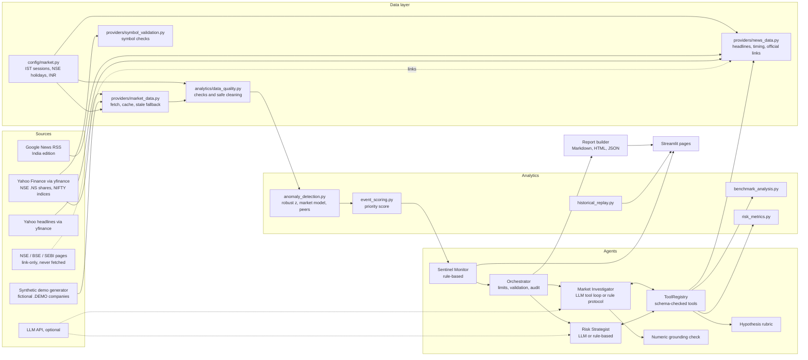
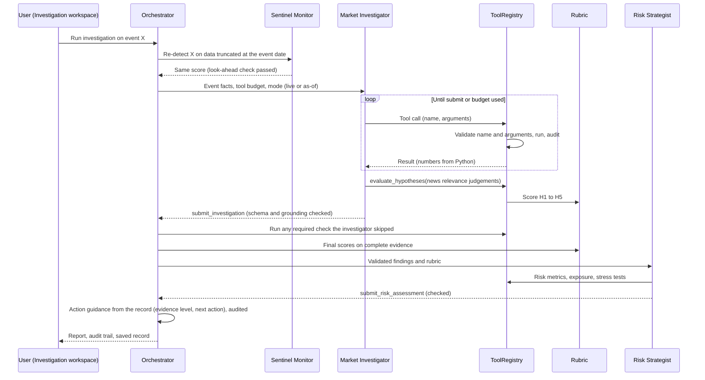

# Architecture (India version)

Market Sentinel is a single Python application. Streamlit draws the interface, ordinary Python modules do the
analysis, and three agent roles are coordinated by a plain Python orchestrator. There is no separate backend server
and no database: market data is cached as CSV files and each investigation is saved as a JSON record.

## Components

## One investigation, step by step

## Responsibilities

| Module | Responsibility |
|---|---|
| `config/settings.py` | Every threshold, window and weight; environment variables for keys and options |
| `config/market.py` | NSE conventions in one place: Asia/Kolkata, 09:15 to 15:30 IST session, 16:15 IST final-bar rule, holiday table 2024 to 2026, INR and rupee formatting, official link-only pages |
| `config/watchlist.py` | The live universe (25 NSE shares, NIFTY 50, 3 NSE sector indices, SENSEX), peer groups, company aliases, the fictional demo universe and the illustrative ₹1 crore portfolio |
| `providers/market_data.py` | yfinance provider (dates read in the exchange's time zone), throttling, retries, circuit breaker, CSV cache, demo generator on the NSE calendar with ten planted scenarios |
| `providers/news_data.py` | Google News India, Yahoo headlines, fictional demo announcements, 15:30 IST timing windows, alias-aware keyword relevance, link-only official pages |
| `providers/symbol_validation.py` | Checks each configured symbol: rows, history, INR, exchange, time zone, type, freshness, volume |
| `providers/llm.py` | Anthropic and OpenAI-compatible tool-calling clients over plain HTTPS, with provider-directed waits on HTTP 429 |
| `analytics/*` | All calculations: returns, robust z-scores, market model, peers, score, VaR, replay outcomes |
| `agents/sentinel_monitor.py` | Agent 1: scans the universe, groups alerts into episodes, flags events to escalate |
| `agents/market_investigator.py` | Agent 2: LLM tool loop or rule-based protocol, plus template findings |
| `agents/risk_strategist.py` | Agent 3: risk interpretation from tools, LLM or rule-based |
| `agents/orchestrator.py` | Runs the roles, enforces required checks, handles failures, assembles and saves the record |
| `agents/tools.py` | Tool specs, argument validation, budgets, audit trail |
| `agents/hypotheses.py` | The five-hypothesis rubric and the confidence rule |
| `agents/guidance.py` | Evidence levels (A, B, C), the business summary, the unresolved-case analysis and the single prioritised next action, built only from the record; recorded in the audit trail as "Action guidance" |
| `analytics/alert_view.py` | The alert-table contract and filters, concise alert labels and plain-English alert reasons |
| `agents/grounding.py` | Flags any figure in LLM text that does not match a tool output |
| `agents/trace.py` | Model decisions and engine facts, read back from the audit trail for the interface and the LLM check |
| `reports/report_builder.py` | The 14-section report in Markdown and printable HTML |
| `ui/*` | Theme, shared components and the six pages |
| `launch.py`, `run_app.bat`, `run_app.command` | One-click start: build `.venv` on first run, install packages, start the app on a free port, open the browser |
| `scripts/make_share_zip.py` | Clean zip for sharing, leaving out `.env`, `.venv`, cached data and saved investigations |
| `scripts/validate_symbols.py` | Live check of all 30 configured symbols on the user's computer; writes `docs/symbol_validation_result.md` |
| `scripts/smoke_test.py` | Live check of every provider and the full pipeline on the user's computer |
| `scripts/llm_check.py` | One real LLM investigation, printed turn by turn; reports PASS, PARTIAL or FAIL per agent |

## Design decisions

The monitor is rule-based on purpose. Alerts must be reproducible and testable, so they come from documented
statistics rather than from a model's judgement.

The LLM never produces numbers. It chooses tools and arguments, judges whether headlines are relevant, and writes
the narrative. A grounding check compares every figure it writes with the tool outputs and asks for one revision if
something does not match; anything still unmatched is flagged in the report.

Hypothesis scores come from a fixed rubric. This keeps the conclusion auditable: the report lists each criterion,
its points and the evidence behind it. The only qualitative input is the relevance label of each news item, and the
report records whether that label came from the LLM (with its rationale) or from the keyword heuristic.

The orchestrator owns the safety rules: tool budgets, turn limits, schema validation, required checks, fallbacks
and the audit trail. An agent cannot skip a required check silently, and a failed LLM step is reported as failed.
Any unusable reply from a provider, not only an error status, ends the model step and triggers the labelled fallback.

What the model sees is designed as carefully as what it may do. Every tool result reaches it as complete JSON of at
most 9,000 characters: long lists are shortened with a note saying what was left out, never cut mid-way. A busy news
day can return close to a hundred items, so `search_public_news` returns counts by timing and relevance and a
balanced sample (company announcements first, then a few items from every group), and `list_news_items` lets the
model page through the rest, including items that could contradict the leading explanation. Prompts and tool results
carry the market facts (NSE, Asia/Kolkata, INR, NIFTY 50), company names with NSE symbols, and publication times in
IST.

Everything that depends on the exchange sits in `config/market.py` and `config/watchlist.py`. The statistics, the
agent loop, the rubric and the interface read those two modules instead of hard-coding a market, which is how the US
version was converted to India without rewriting the analytics.

Official NSE and BSE announcements are link-only by design: NSE's terms of use prohibit automated collection, so the
evidence layer returns the official pages for a manual check and never claims an automated filing search.

Historical investigations run on a dataset physically truncated at the event date, with news after that day's close
excluded, so the as-of guarantee does not depend on every function being written carefully.
